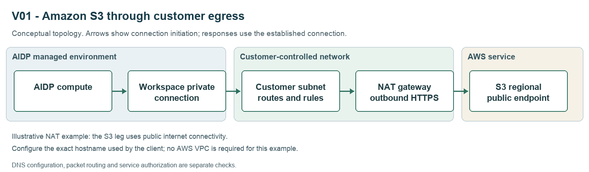
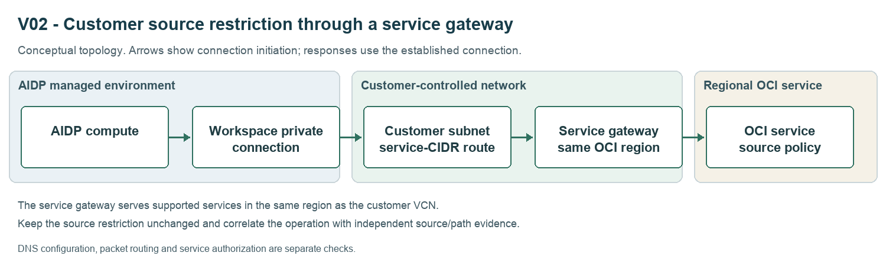
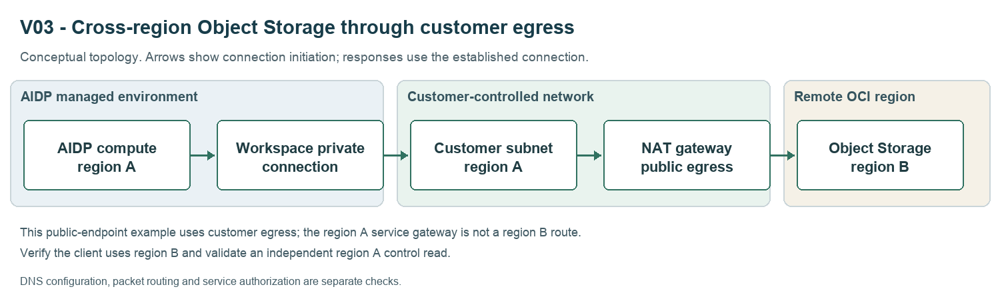
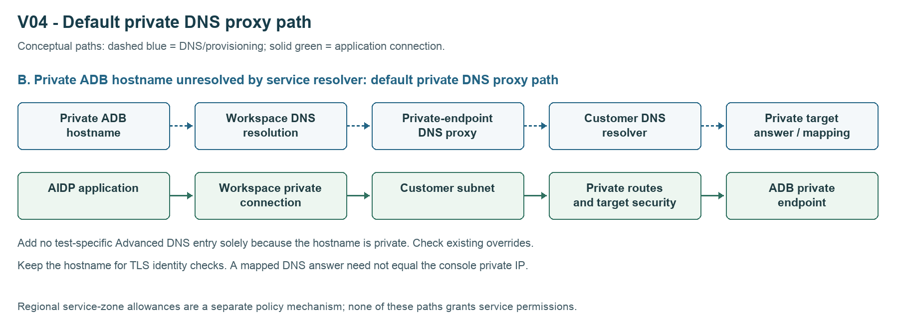

# Test private workspace connectivity

Use this guide to choose a connectivity scenario, prepare your own network, and open the notebook for that scenario. The samples are independent: each includes its own configuration, network setup, diagram, procedure, checks, evidence template, and restoration steps.

The notebooks do not provision resources, edit workspace DNS, change permissions, install libraries, or start/stop compute. Start with existing resources and your approved change plan. All distributed notebooks have empty outputs and live execution disabled.

## Choose your use case

| ID | Choose this when you want to... | Notebook |
| --- | --- | --- |
| V01 | Read a private S3 object through customer-controlled outbound connectivity. | [Amazon S3](V01_Amazon_S3.ipynb) |
| V02 | Preserve a customer Network Source restriction while accessing an in-region OCI service. | [Network Source and service gateway](V02_Customer_Network_Source.ipynb) |
| V03 | Read OCI Object Storage in a region different from your AIDP workspace. | [Cross-region Object Storage](V03_Cross_Region_Object_Storage.ipynb) |
| V04 | Query an existing database through its actual service-private endpoint. | [Service private endpoint](V04_Service_Private_Endpoint.ipynb) |
| V05 | Record configuration and authenticated access for the OCI service endpoints you select. | [Service hostname coverage](V05_Service_Hostname_Coverage.ipynb) |
| V06 | Check scoped DNS add/edit/delete/cancel and input-validation behavior. | [DNS edits and validation](V06_DNS_CRUD_And_Validation.ipynb) |
| V07 | Measure continuity for a DNS change that your deployment supports without stopping compute. | [DNS without a Spark restart](V07_DNS_Without_Restart.ipynb) |
| V08 | Preserve a working database connection while changing unrelated DNS entries. | [Existing connection preservation](V08_Existing_Connection_Preservation.ipynb) |

V01-V04 are customer connectivity scenarios. V05-V08 check endpoint coverage, configuration behavior, continuity, and compatibility. A result from one scenario does not validate another.

## Why run V05–V08?

These cases examine additional Advanced DNS behavior beyond establishing a connection. See the [validation scope and manual acceptance steps](docs/advanced-dns-validation.md) for detailed procedures and limits, also embedded in the corresponding notebooks.

| Case | Advanced DNS objective | What the current test establishes | Additional evidence needed |
| --- | --- | --- | --- |
| V05 | Automatic handling of eligible service endpoints, reducing manual entries and support requests. | Selected endpoint configuration and authenticated operations. | Eligibility, a baseline without a manual entry or historical override, and successful access before adding any entry. Coverage alone does not prove automatic inclusion. |
| V06 | Self-service create/read/update/delete, validation and cancellation. | Supplied saved snapshots and input-validation observations. | Exercise Create/Edit flows where supported; review runtime effects separately. Preserving SCAN settings does not test SCAN functionality. |
| V07 | Apply supported Advanced DNS changes without restarting Spark workloads. | DNS convergence, functional phases, application identity and lifecycle evidence. | Verify deployment support; record any older-cluster adoption restart separately before the measured run. |
| V08 | Preserve existing integrations, including previously support-configured connectivity. | An existing database connection survives unrelated DNS edits. | Historical configuration provenance and an observed adoption transition without another allowlisting request. A general regression pass does not prove legacy adoption. |

Use V01–V04 as the primary connectivity walkthroughs and V05–V08 as supporting operational validation. Automatic inclusion and legacy adoption remain **INCOMPLETE** without their additional evidence, even when the existing endpoint/regression checks succeed. The notebooks do not automate internal rollout, mapping cleanup, feature-flag or telemetry validation.

## IAM policies and network construction examples

Read [network and IAM preparation examples](docs/network-and-iam-examples.md) before enabling live checks. It includes placeholder statements for operator/private-network permissions, bucket-scoped OCI reads, a Network Source condition, AWS S3/KMS reads, a Streaming consume example, database login and evidence access. Route/security tables illustrate NAT egress, a regional service gateway, private database listeners, peering and resolver prerequisites.

The examples distinguish the workspace operator, platform service and actual runtime signer. Select the matching policy subject and only the permissions needed for the chosen operation. An Advanced DNS entry grants no service authorization and creates no route. Existing platform setup and customer-specific service permissions still apply. Every notebook embeds its preparation examples so a single-file import retains them; these are documentation templates, not executed provisioning steps.

## Prepare your environment

1. Choose your own AIDP instance, workspace and test compute. Enable **private network access** with the appropriate customer VCN, subnet and NSGs. Have the network administrator verify the [AIDP workspace prerequisites](https://docs.oracle.com/en/cloud/paas/ai-data-platform/aidug/workspaces.html), service-required security rules, and IAM permissions.
2. Read **Network setup** in the chosen notebook. Supply actual resource hostnames and connection details from the destination service; do not copy an address from another workspace. A translated DNS answer can be normal and is a destination, not a source address to add to a policy.
3. Verify existing routes, return traffic, security rules, name resolution and service permissions independently. Advanced DNS configuration does not create any of those controls. For private/split DNS, confirm that both the configuration operation and runtime resolution select the intended private destination.
4. Record the original workspace DNS/SCAN settings, route/policy references and compute lifecycle state. Use only scoped, disposable changes that your environment permits.
5. Follow the workspace UI's prerequisites before saving a change. The public documentation states that **most network changes require stopped compute**. V07 is conditional on support for the particular live DNS operation; do not bypass a stop requirement to run it.

These examples concern **outbound access to data from a private-network-enabled workspace**. They do not configure private ingress to the Workbench UI, Spark UI, SQL endpoints or agent endpoints.

## Understand the network path

### S3 and other public remote endpoints



The illustrated S3 design uses customer NAT internet egress. No AWS VPC is required for that public endpoint. A separate private OCI-to-AWS interconnect would be a different topology. Verify the regional/bucket-specific endpoint used by the client and preserve the bucket's authorization policy.

### In-region customer source context



A service gateway can reach supported Oracle services **in the same region** over the Oracle network. Verify the customer subnet's service-CIDR route, gateway configuration and security rules. An unchanged source restriction plus correlated request/network evidence is needed to establish the intended source/path. OCI IAM Network Sources and database ACLs are different controls. See [service gateway](https://docs.oracle.com/en-us/iaas/Content/Network/Tasks/servicegateway.htm) and [Network Sources](https://docs.oracle.com/en-us/iaas/Content/Identity/Tasks/managingnetworksources.htm).

### Cross-region public Object Storage



This example uses an approved customer egress path to the remote public endpoint. A region A service gateway is not a route to region B. Select the actual remote endpoint and a fresh client where needed; an already cached filesystem may retain an older endpoint. Keep an independent in-region control fixture. See [NAT gateway](https://docs.oracle.com/en-us/iaas/Content/Network/Tasks/NATgateway.htm) and [HDFS endpoint configuration](https://docs.oracle.com/en-us/iaas/Content/API/SDKDocs/hdfsconnector.htm).

### Service private endpoint



The workspace private connection and the service's private endpoint are distinct components. Use the service's private descriptor, verified customer DNS, private routes and listener security. Another VCN requires the appropriate peering/DRG route and return path. A public ADB endpoint with an ACL does not substitute for this case. Preserve the original authentication and certificate checking. See [Autonomous Database connection modes](https://docs.oracle.com/en-us/iaas/autonomous-database-serverless/doc/connect-introduction.html).

## Run the chosen notebook

1. Import/open the individual notebook in the appropriate workspace and attach your test compute. Its diagram is embedded as a notebook attachment, so importing the notebook alone preserves the image. The repository also supplies the same PNG under `assets/` for viewers that do not display notebook attachments.
2. Complete the empty `CONFIG` fields using your environment. Workspace and compute labels identify the evidence; they do not change the selected runtime. No tenancy, workspace, database or bucket values are prescribed by the sample.
3. For object reads, use a CSV fixture no larger than 64 KiB with known exact rows. The optional [synthetic fixture](fixtures/sample.csv) has two rows. Verify its size independently, upload it using your normal approved tooling, and supply the object URI, namespace/region/endpoint and expected values. No object is uploaded by the notebook.
4. For ADB, prefer an existing workspace external catalog connection. Otherwise use an existing supported wallet ZIP, TNS alias and private runtime secret. A wallet directory is not a ZIP file. For S3, configure a supported S3A credential provider and runtime-compatible libraries before comparing network behavior. Never save credential values in notebook source or commit executed outputs containing private details.
5. Run the helpers cell once. Set `RUN_LIVE=True` only when the workload prerequisites are ready. For manual Workbench/evidence scenarios, record actual observations before enabling `RUN_EVIDENCE_CHECKS`. Both flags default to `False`.
6. Record a baseline, apply only the approved scoped change, reopen saved settings and repeat the same client/identity. For repeated phases, preserve `RESULTS`; do not rerun the configuration cell and erase earlier observations.
7. Restore only changes introduced by the run, repeat the original control, and export a new run-specific evidence file privately. Preserve resources already in use.

The CSV check compares an exact row multiset, so order differences are allowed but missing, extra or duplicated rows fail. The ADB check runs a read-only database-identity query. Driver DNS/TCP results describe the driver; a Spark read exercises its distributed reader but does not prove every executor or a particular network path was covered.

## Interpret the evidence

| Dimension | What a passing check establishes | What still needs separate evidence |
| --- | --- | --- |
| Configuration | Captured save/readback matches the intended scoped settings. | Actual workload behavior and route. |
| DNS | The recorded runtime resolves the actual hostname. | Gateway traversal, target identity and service authorization. |
| TCP | The selected host/port accepts a connection. | TLS identity and an authenticated service operation. |
| Functional | Exact fixture rows or the intended database identity were returned. | Source route, private endpoint type and client-certificate use. |
| Source/path | Correlated target/network records support the intended route and source context. | Review the artifacts; a supplied observation flag alone is not proof. |
| Continuity | Recorded application identity and lifecycle support continued operation across actual changes. | A stable display name alone does not prove absence of restart. |

Database username/password authentication and mTLS client-certificate authentication are separate. A wallet-configured successful query, `TCPS`, or port 1522 alone does not independently prove mTLS; ADB can support TLS-only on port 1522 too. Review the effective connection descriptor, actual client identity use, and applicable server/handshake evidence. Do not weaken server requirements for a comparison.

`PASS` applies to one check. `FAIL` means an executed check did not meet its criterion; `BLOCKED` means a prerequisite is missing; `NOT_RUN` means it was not attempted. Supplied observations and remaining external evidence yield `REVIEW_REQUIRED` or `INCOMPLETE`, rather than an automatic overall acceptance PASS. Raw connector exception text is omitted because it may include secrets; diagnose detailed errors privately in your runtime.

## Maintain and verify the samples

Keep this guide open as the entry point, or import README.md alongside a notebook if you want its relative back-link available in AIDP.

Maintain rationale in `docs/advanced-dns-validation.md` and preparation templates in `docs/network-and-iam-examples.md`, then regenerate notebooks. The generator embeds the relevant sections, including supporting network patterns, rather than requiring customers to download the documentation directory.

The notebooks use the Python standard library plus the existing Spark/connector runtime. No extra Python package is required by the harness. From this sample directory, regenerate notebooks after source edits:

```bash
python3 build_notebooks.py
python3 -m unittest discover -s tests -p 'test_*.py' -v
```

Only diagram regeneration needs Pillow from `requirements-build.txt`:

```bash
python3 build_diagrams.py
python3 build_notebooks.py
```

Tests are offline; they verify assertions, generated notebook isolation, links, embedded images and cleared outputs. They do not certify connectivity in any customer's network. Generated notebooks and diagrams are committed so customers do not need the build tools.

## License

Copyright (c) 2026 Oracle and/or its affiliates. Licensed under the Universal Permissive License (UPL), Version 1.0. See [LICENSE.txt](../../LICENSE.txt).
