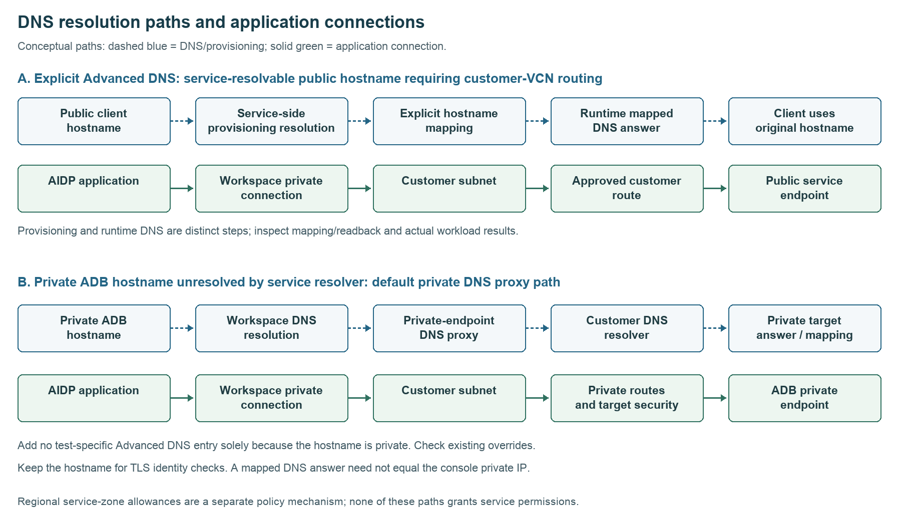

# Distinguish DNS resolution paths

## Resolution paths

Advanced DNS explicit entries and default private DNS proxy resolution serve different purposes. Determine the hostname's resolution path before editing the workspace.

| Mechanism | Resolution and traffic behavior | What to configure or verify |
| --- | --- | --- |
| Explicit Advanced DNS entry | Provisioning resolves the supplied public hostname from the service environment and installs an explicit mapping. The runtime DNS answer directs application traffic through the workspace private connection into the customer VCN. | Use a service-resolvable hostname requiring customer-network routing, then verify provisioning, saved state, workload DNS and the authenticated operation. A customer-VM lookup alone does not establish service-side resolvability. |
| Default private DNS proxy path | A private ADB hostname that the service resolver cannot resolve is handled through the private-endpoint DNS proxy and customer DNS context. | Verify customer DNS, private routes, listener security and the private descriptor. Do not add the private hostname solely because it is private. |
| Regional service-zone allowance | A regional service-domain policy permits covered zones in the applicable context. | Verify the deployment's eligibility and endpoint. This is neither an automatically inserted workspace entry nor proof that the private DNS proxy supplied the answer. |

Dashed blue arrows describe DNS/provisioning relationships; solid green arrows show application connections. The diagram is conceptual, not a packet trace. An address returned inside AIDP can be a service-managed mapping and need not equal the private address in the destination console. Keep using the original hostname for TLS server identity checks.

**Before testing:** record the complete DNS/SCAN list, endpoint type, existing overrides and effective client configuration. A successful query alone does not identify the resolution mechanism. Do not delete a shared override to create a clean baseline. Use an approved clean test workspace or mark the default-path claim **INCOMPLETE** when provenance cannot be established.

For V04, first test the private endpoint without adding a test-specific Advanced DNS entry. For V01–V03, V06 and V07, explicit-entry tests require service-resolvable hostnames; private-only names are unsuitable for demonstrating that provisioning mechanism. An unresolved owned name can remain a deliberately negative V06 test.

The [public workspace guide](https://docs.oracle.com/en/cloud/paas/ai-data-platform/aidug/workspaces.html) lists broad private-network scenarios; endpoint type and deployed resolver behavior determine whether an explicit entry is necessary. The [ADB private endpoint guide](https://docs.oracle.com/en/cloud/paas/autonomous-database/serverless/adbsb/private-endpoints-autonomous.html) describes the destination's private access setup. Confirm your deployment's behavior with the administrator and retain independent evidence for the resolution path you claim.

## License

Copyright (c) 2026 Oracle and/or its affiliates. Licensed under the [Universal Permissive License](../../../LICENSE.txt), Version 1.0.
